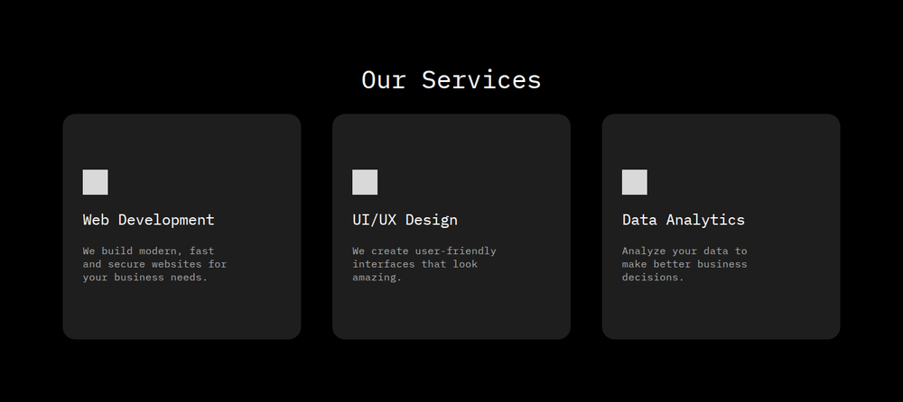
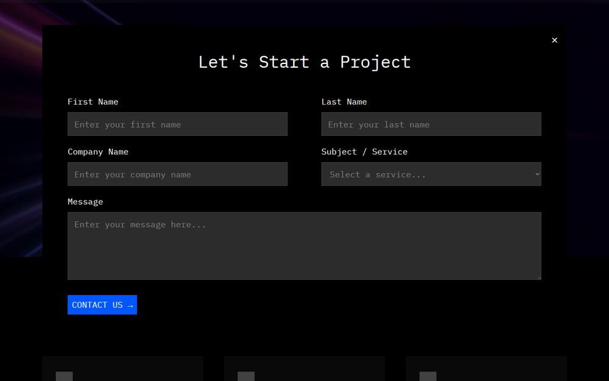

# CSSM Group Website

The landing page of CSSM Group: a dark, monospace-driven site that shows what the company does, who is behind it, and how to start a project in one click.

- **Plain HTML and CSS.** No framework and no build step. Open `index.html` and it works.
- **[IBM Plex Mono](https://fonts.google.com/specimen/IBM+Plex+Mono).** One typeface across the whole page, loaded from Google Fonts.
- **Responsive.** Designed at 1440 px and adapted for tablets and phones.
- **Contact form in a native `<dialog>`.** It closes with Escape, the close button, or a click outside the form.

## Screenshots

| Hero | Services |
| :---: | :---: |
|  |  |
| **About Us** | **Contact form** |
|  |  |

## Project layout

```text
cssm-group-website/
+-- index.html                  # Page markup and the modal form script
+-- style.css                   # All styles and responsive rules
+-- docs/
|   \-- images/                 # Screenshots for this README
\-- images/
    +-- hero.png                # Hero background
    \-- about.jpg               # Photo for the "About Us" section
```

## Local development

No dependencies are required. You can open `index.html` directly in a browser, or serve the folder with any static file server:

```bash
# Clone the repository
git clone https://github.com/ChernegaSergiy/cssm-group-website.git
cd cssm-group-website

# Serve the site locally
python3 -m http.server 8000
```

Then open `http://localhost:8000`.

## Deploy

The site is fully static, so it can be hosted on any static hosting service, such as GitHub Pages. Publish the repository root (`index.html`, `style.css`, and `images/`) as is.

## Customization

- **Colors and spacing.** The main colors and the side padding are CSS variables at the top of `style.css` (`:root`).
- **Images.** Replace `images/hero.png` and `images/about.jpg` with your own files of the same name, or change the paths in `style.css`.

## Contributing

Contributions are welcome and appreciated! Here's how you can contribute:

1. Fork the project
2. Create your feature branch (`git checkout -b feature/AmazingFeature`)
3. Commit your changes (`git commit -m 'Add some AmazingFeature'`)
4. Push to the branch (`git push origin feature/AmazingFeature`)
5. Open a Pull Request

Please make sure to update tests as appropriate and adhere to the existing coding style.

## License

This project is licensed under the CSSM Unlimited License v2.0 (CSSM-ULv2). See the [LICENSE](LICENSE) file for details.
